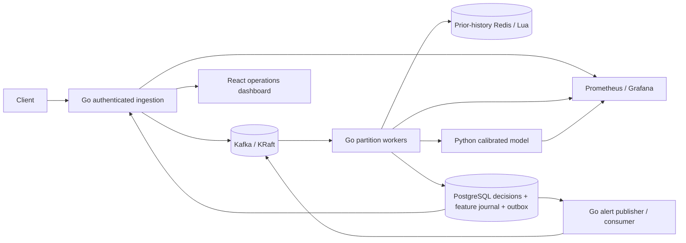
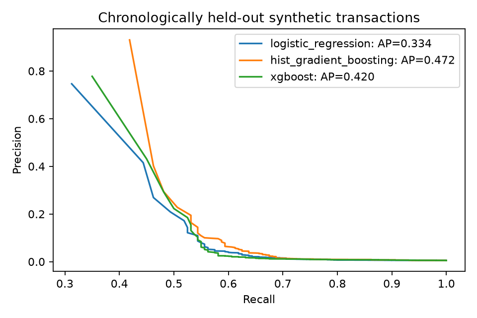
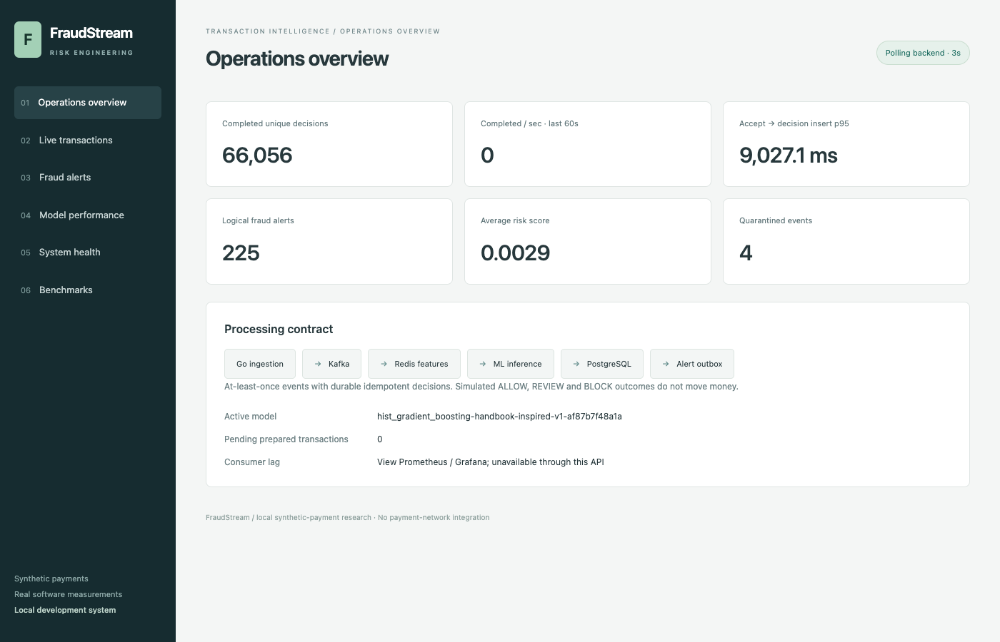
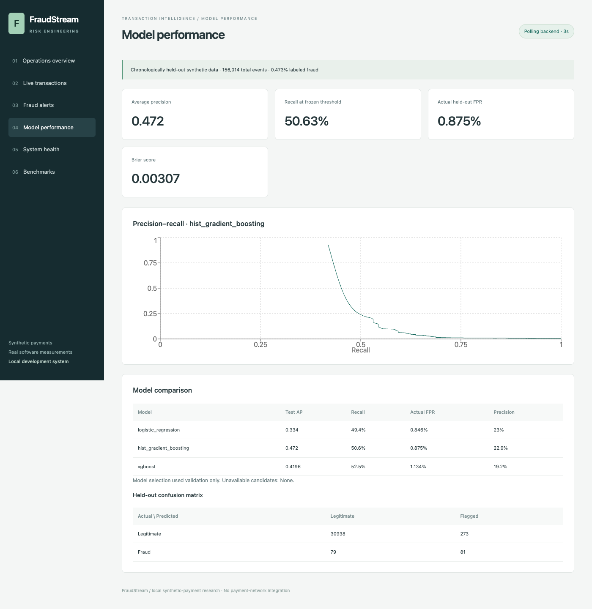

# FraudStream

Real-time fraud detection architecture with Go event processing, prior-history Redis features and calibrated Python ML inference. Transactions are accepted asynchronously through Kafka; workers persist simulated risk decisions in PostgreSQL and publish alerts through a transactional outbox.

**Verification status (2026-10-11):** the full distributed stack has been built and run end to end in Docker on Apple Silicon: Go ingestion → Kafka → Go worker → Redis Lua features → Python inference → PostgreSQL decisions → transactional alert outbox → Kafka alert consumer. All eight injected crash points recover with exactly one durable decision and no lost logical alerts. Go `gofmt`/`vet`/race tests, 24 Python tests, Ruff/mypy, the frontend build and a headless-browser check of every dashboard tab pass. Three models, including XGBoost, were trained and logged to MLflow. See [testing](docs/TESTING.md), [benchmark results](docs/BENCHMARK_RESULTS.md) and [limitations](docs/LIMITATIONS.md). It is a single-node development deployment, not a highly available production system.

## Architecture



The original engineering work centers on the versioned feature contract, independent offline/online implementations, durable feature-intent recovery, idempotent decision/outbox protocol and reproducible benchmark boundaries. Frameworks provide Kafka transport, Redis execution, SQL constraints, model estimators and HTTP routing. [Full architecture](docs/ARCHITECTURE.md) and [decisions](docs/DESIGN_DECISIONS.md) explain the tradeoffs.

## Measured results

All numbers below come from executed runs with raw artifacts under [benchmarks/results](benchmarks/results) and [ml/artifacts](ml/artifacts); hardware is one Apple Silicon laptop running every container.

**Model quality.** On 31,371 chronologically held-out synthetic transactions (156,014 total, 0.473% fraud), calibrated histogram gradient boosting achieved **0.472 average precision** and **50.6% recall at 0.875% actual FPR**. It was selected on validation AP over XGBoost (test AP 0.420) and logistic regression (0.334).

**Throughput.** One partition and one worker sustain **~220–290 unique durable decisions/sec** when the backlog drains without client polling (18,000 transactions, 0 errors). Committing Kafka offsets once per fetched batch instead of once per record raised this from **~105 to ~228 decisions/sec (2.1×)** in an A/B of the same drain workload. Scaling to 4 partitions and 1/2/4 workers stays flat at **~290–300/sec**: the global feature sequencer is the measured bottleneck.

**Latency.** Under light closed-loop load a committed decision is observable **~25 ms p50 / 27 ms p95** after the HTTP 202 (bounded below by the client's 20 ms poll interval). Inside the worker, a transaction averages ~4.6 ms of processing: 1.3 ms inference HTTP, 0.6 ms decision write, 0.2 ms feature snapshot.

**Features.** Against real Redis, the atomic server-side Lua implementation processed **800–920 events/sec vs 190–230** for a client-side aggregation baseline (≈4×), with lookup p95 **0.58–0.91 ms vs 1.5–3.1 ms** across 10/100/1,000 entities.

**Recovery.** Crashing the worker before/after feature intent, feature materialization, inference, persistence and offset commit, and crashing the alert publisher mid-publication, each recovered in **6.1–7.3 s** with **0 duplicate and 0 missing decisions** and at most one logical alert.



[Benchmark methodology](docs/BENCHMARKS.md) defines each metric and its measurement boundary.

### Defects found by running the system

Running the real stack exposed defects that unit tests with mocks had not:

- **Per-record synchronous offset commits** cost ~5.8 ms each, more than the ~4.6 ms of processing; batching per partition doubled throughput.
- **45 s crash recovery**: a crashed consumer never leaves the group, so the franz-go default session timeout held its partition. `KAFKA_SESSION_TIMEOUT_MS` now defaults to 6 s.
- **Silent loss of quarantined events after Kafka offset reuse**: quarantine rows were keyed on topic/partition/offset with `ON CONFLICT DO NOTHING`. Migration `002` adds the payload hash to the key.
- **Full-table scan per decision lookup**: a shared `$1='' OR id=$1` predicate produced a generic plan that ignored the primary key.
- **Dashboard 502s after an ingestion restart** (nginx cached the upstream IP) and **404 model/benchmark reports** (relative paths inside a distroless image).
- A Go build break (`Dockerfile.go` parsed as Go source), a nonexistent pinned `xgboost` version, and missing `go.sum`.

## Quickstart

Prerequisites: Go 1.26.x (or Docker, which builds the services), Python 3.12+, uv, Node 22+, and Docker Desktop with roughly 6 GB of memory for the core stack; monitoring is optional. Keep the checkout outside an iCloud-synced folder such as Desktop or Documents: macOS can evict files from those folders and reads then time out.

```sh
make setup             # Python deps, random ignored .env, Go dependency sums
make fmt               # Go/Python formatting; required before first Go CI run
make train             # generate data, compare three models, log MLflow artifacts
make test              # lint, typing, Python tests, Go race tests/vet
make up                # Kafka KRaft, Redis, PostgreSQL, inference, Go services, dashboard
make migrate           # only for a database volume created before the latest migration
.venv/bin/python scripts/wait_ready.py
make smoke
make demo
make monitoring        # optional Prometheus + Grafana profile
make benchmark
.venv/bin/python -m benchmarks.pipeline --mode drain --concurrency 10 50 100 --count 2000
.venv/bin/python -m benchmarks.features
make integration       # includes deliberate process crashes; use a local dev stack
make down              # preserves Docker data volumes
```

`make train-local` permits a missing XGBoost install and skips MLflow; it is a limited fallback, not the standard three-model workflow.

Dashboard: `http://localhost:5173`. Enter your local `API_KEY` from `.env`; it stays in browser memory. Inference: `http://localhost:8001/model/info`. Optional Grafana: `http://localhost:3000`; user `admin`, password from `POSTGRES_PASSWORD`. Prometheus: `http://localhost:9090`.

| Operations overview | Model performance |
|---|---|
|  |  |

## Transaction contract

`POST /api/v1/transactions` requires `Authorization: Bearer <API_KEY>`. Schema v1 supports USD PAYMENT amounts with at most two decimals. Identifiers are stable, ASCII and bounded. Unknown fields, including fraud labels, are rejected.

```json
{
  "schema_version": 1,
  "transaction_id": "example-001",
  "source_event_id": "example-001",
  "customer_id": "c42",
  "merchant_id": "m7",
  "amount": 125.50,
  "currency": "USD",
  "transaction_type": "PAYMENT",
  "timestamp": "2025-01-01T12:00:00Z"
}
```

Successful publication returns **202 pending**, stable transaction ID, acceptance timestamp, correlation ID and a Location for the decision. Query `GET /api/v1/transactions/{id}/decision` for the scored record. It includes the actual risk score, ALLOW/REVIEW/BLOCK band, model version and persistence timestamp. `precommit_ms` spans API acceptance to the decision INSERT, so it includes Kafka queueing but excludes COMMIT; it is not a durable-decision benchmark. No example risk score is supplied as if measured for this illustrative transaction. The endpoints `/health`, `/ready` and `/metrics` expose service status and telemetry.

## Features, consistency and failure handling

The same 15-value `prior-v1` feature contract is implemented independently in Python and Redis Lua. It includes current amount/time, customer 5m/1h/24h counts, spending sums, 24h mean/amount ratio, recency/diversity and 1h merchant volume/mean/customer diversity. All history precedes the current event; equal-time prior applied events are included. No fraud label enters inference.

Manual offset commits follow durable decisions or durable quarantine rows. SQL uniqueness and stable alert IDs handle repeated events. A durable feature intent precedes Redis mutation so retries can reuse the same scoring vector. A feature sequencer serializes shared customer/merchant history; inference runs outside it. Pending materializations reconcile before new snapshots. Outbox publication may duplicate physical Kafka messages after a crash; logical alerts deduplicate. This is **at-least-once delivery with idempotent durable outcomes**, not end-to-end exactly-once execution.

V1 allows **zero event-time lateness** per customer and merchant. Regressions are quarantined rather than silently scored with incomplete history. One Kafka partition and ordered historical replay are the supported deterministic path. Multiple partitions may introduce merchant regressions; the global sequencer and strict policy constrain scaling. These are deliberate tradeoffs, documented rather than hidden.

## Data and evaluation

The local generator is an original **Handbook-inspired** simulation, not the canonical upstream dataset. It does not redistribute GPL simulator code or Kaggle PaySim files. It uses one-day buffers and a deterministic seed; raw events/labels remain separate from processed disk-backed features. [Dataset provenance](docs/DATASET.md) compares sources and records licenses, rules, sizes and biases.

Chronological fitting uses only labels available at the cutoff. Later disjoint segments calibrate probabilities and select thresholds/models; the test set is evaluated only after the choice is frozen. Reports include AP, ROC-AUC, precision/recall/F1, actual test FPR, confusion matrices, Brier score, calibration and PR curves. [ML evaluation](docs/ML_EVALUATION.md) records results and caveats.

## Replay, experiments and tests

```sh
make smoke
make demo
.venv/bin/python -m streaming.replay --count 100 --wait-each --duplicates
.venv/bin/python -m streaming.replay --count 100 --reverse  # intentional strict-lateness quarantine
make benchmark-local
.venv/bin/python -m benchmarks.pipeline --count 1000 --concurrency 1 10 25 50 100
.venv/bin/python -m benchmarks.pipeline --mode drain --count 2000 --concurrency 10 50 100
.venv/bin/python -m benchmarks.features --count 2000 --entities 10 100 1000
.venv/bin/python -m scripts.integration
sh scripts/scale.sh
make report
make test-python
```

Historical replay should start before newer-timestamp workloads touch the same entities. Replaying older input after a current-time benchmark follows the strict lateness policy and can be quarantined. For an independent demo, use fresh entities/state or a fresh isolated Compose project; do not delete shared volumes blindly.

Benchmark JSONs preserve raw durations, dataset/model versions, source hash, seed, concurrency and measurement boundaries. Fault scripts wait for an injected process exit before making recovery assertions. Blocked artifacts remain blocked, never successful runs. The dashboard shows actual backend records, measured model reports and explicit unavailable states. No mock runtime metrics are substituted.

## Security, limitations and next work

This is a synthetic-payment development platform with API authentication, bounds, rate limiting, environment secrets and loopback-bound infrastructure. It has no payment-network integration, PCI-DSS claim or bank production-readiness claim. [Threat model](docs/THREAT_MODEL.md) covers trust boundaries and unimplemented production controls.

Priority next work is entity-consistent feature sharding to remove the global sequencer (the measured scaling bottleneck), infrastructure-outage tests under load (Redis/PostgreSQL/inference unavailable), open-loop fixed-rate load generation, a resumable Redis rebuild and rolling delayed-label monitoring. [Limitations](docs/LIMITATIONS.md) lists what is not yet demonstrated.
