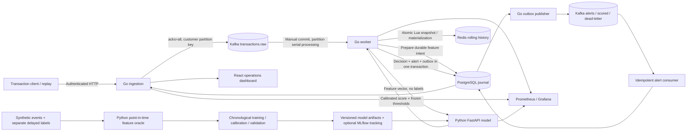

# Architecture

The Go services own transport, consumer offsets, bounded concurrency and persistence. Python owns data preparation, model comparison, calibration and serving. No real payment operation occurs. The dashboard polls authenticated backend endpoints every three seconds.

## Processing protocol

1. Ingestion rejects invalid schemas, extra fields, unsupported currency/type, amounts outside bounds, more than two decimal places and excessive payloads. A global fixed-window rate limiter and bounded in-flight channel reject overload. HTTP 202 is returned only after synchronous Kafka acknowledgment.
2. Workers use a consumer group with auto-commit disabled. Each fetched partition runs serially. Partition handlers are bounded by a semaphore. One offset commit per fetched partition batch covers the last record with a durable decision or durable quarantine/outbox insert; on failure only the durable prefix is committed. A 6 s consumer session timeout (`KAFKA_SESSION_TIMEOUT_MS`) bounds how long a crashed worker holds its partitions. Rebalances are blocked while processing the fetched batch, then explicitly allowed.
3. PostgreSQL's feature sequencer advisory lock serializes customer and merchant history across worker processes. Under that lock, pending feature intents are reconciled first. Redis computes prior-history features; the event and feature vector are committed to SQL before Redis materialization. A crash after the intent or after materialization is recoverable through the journal.
4. Inference runs outside the feature sequencer. Retries use the frozen feature vector. Unique transaction/source IDs, primary-key decisions and unique alert transaction IDs enforce durable idempotency.
5. A decision transaction inserts model registration, decision, logical alert and outbox rows. Outbox publishers use `FOR UPDATE SKIP LOCKED`; publication is confirmed before marking a row delivered. A crash between publish and mark can duplicate physical Kafka messages. Logical alert IDs and idempotent consumer updates tolerate that duplicate.

## Feature recovery and ordering

Redis is derived state; PostgreSQL stores feature intents and their exact vectors. Missing generation metadata triggers a rebuild into a fresh namespace in journal sequence, then publishes the completed generation. The system assumes Redis `noeviction`, no TTL on watermarks, and no external key mutation. Silent deletion of individual entity keys is **not** detected by the generation marker. A full Redis reset is detectable. Large rebuilds may exceed the current 15-second attempt budget and require an explicit maintenance window; resumable rebuild checkpoints remain a limitation.

Event-time lateness allowance is **zero seconds per customer and merchant**. An earlier timestamp is durably quarantined; it never retroactively changes a score. Equal timestamps use committed journal order and include prior applied events at that timestamp. One Kafka partition and ordered replay are the reproducible v1 path. Multiple partitions preserve customer order but can cause shared-merchant regressions; quarantine rates must be reported in scaling experiments. No buffered watermark or correction scheme is claimed.

## Feature contract `prior-v1`

Both the Python reference and Redis Lua return the same ordered 15-value vector. Windows use inclusive lower/upper bounds `[t-window,t]`, exclude the current event, and include previously applied events with the same timestamp. Customer counts cover 5m/1h/24h, sums 1h/24h, mean and merchant diversity 24h; merchant count/mean/customer diversity cover 1h. The amount ratio is zero for no history. First-customer recency is 86,400 seconds. Hour/day are UTC, Monday=0. Transaction type is constant PAYMENT and currency constant USD, so neither is included as a redundant numeric feature.

History sorted sets are trimmed on apply by event time. Four persistent keys per active customer/merchant pair of entity types hold history and watermarks. Active cardinality and transaction velocity determine memory. Idle entities retain metadata/history until they are active again; no bounded total entity cardinality is guaranteed. A 50,000-record per-window cap fails closed. Redis Cluster cross-slot scripts are unsupported. These are concrete capacity and scalability limits, not a production-scale design claim.

## What is validated

The Python oracle and actual Lua script pass automated parity tests in fakeredis/Lua, including boundaries, duplicates and strict lateness. On real Kafka/Redis/PostgreSQL containers, the integration suite verifies duplicate handling, strict-lateness quarantine and recovery from eight injected crash points with exactly one durable decision each; see [TESTING.md](TESTING.md). Quarantine rows are keyed by topic, partition, offset and payload hash so reused Kafka offsets cannot drop events. Remaining gaps are listed in [LIMITATIONS.md](LIMITATIONS.md).
